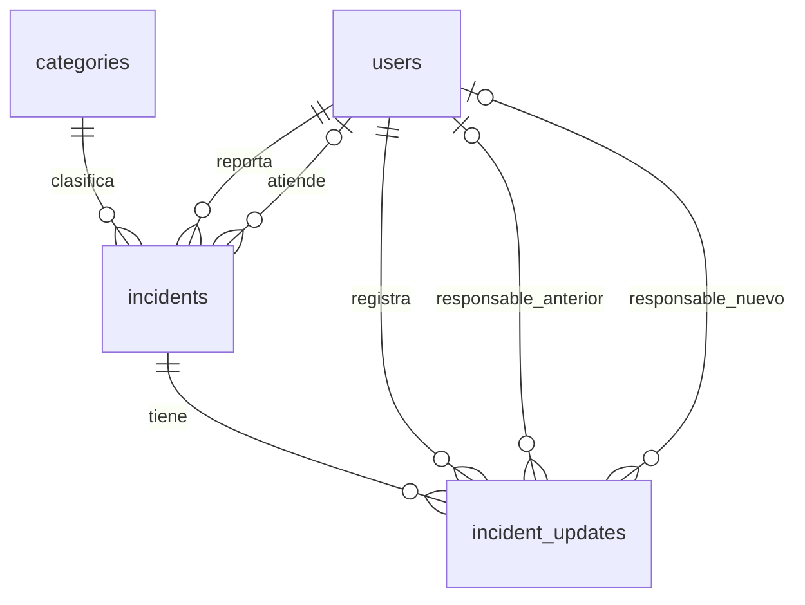

# Base de datos de CampusFix

Entregable de Daniel Díaz para la semana 1. PostgreSQL 16, rama
`feature/db-schema`, revisión por Alex Rodríguez.

## Modelo y relaciones



| Tabla | Propósito y campos principales |
| --- | --- |
| `users` | Nombre, correo único sin distinguir mayúsculas ni espacios exteriores, hash de contraseña y rol. |
| `categories` | Nombre único y descripción opcional del tipo de problema. |
| `incidents` | Título, descripción, ubicación, categoría, autor, responsable opcional, estado, prioridad y fechas. |
| `incident_updates` | Incidencia, usuario que hizo el cambio, estados y responsables anterior/nuevo, comentario opcional y fecha. |

Todos los identificadores son `BIGINT` generados por PostgreSQL. En JSON, la API
deberá serializarlos como cadenas para evitar pérdida de precisión en JavaScript.
Las fechas usan `TIMESTAMPTZ`; la interfaz puede mostrarlas en la zona del usuario.
Las claves foráneas impiden referencias inexistentes y borrados que dejen
incidencias o historial sin sus usuarios, categoría o reporte.

Convenciones propuestas para integrar la API (confirmar con el equipo):

| Campo | Valores | Predeterminado |
| --- | --- | --- |
| `users.role` | `student`, `technician`, `admin` | `student` |
| `incidents.status` | `open`, `in_progress`, `resolved`, `closed` | `open` |
| `incidents.priority` | `low`, `medium`, `high` | `medium` |

Los índices cubren relaciones, filtros por estado/prioridad, listado por fecha
e historial por incidencia. Para ordenar el historial usar `created_at, id`.
`password_hash` debe contener un hash seguro generado por el backend, nunca la
contraseña original; no debe incluirse en las respuestas de la API.

## Crear y verificar la base local

Desde la raíz del repositorio, con Docker Desktop iniciado:

```powershell
docker compose config -q
docker compose up -d --wait db
docker compose exec -T db psql -U campusfix -d campusfix_dev -c '\dt'
Get-Content -Raw apps/api/db/tests/schema.sql | docker compose exec -T db psql -v ON_ERROR_STOP=1 -U campusfix -d campusfix_dev
```

En una base nueva, el contenedor aplica automáticamente la
[migración inicial](./migrations/001_initial_schema.sql). Solo se levanta el
servicio `db`, así se puede probar sin esperar a que exista el backend.
Esperar a que el servicio esté saludable antes de ejecutar las consultas
(`docker compose ps db`). La prueba debe mostrar `Schema checks passed` y
terminar con código 0. Usa una transacción que revierte sus filas de prueba;
las secuencias pueden avanzar aunque se revierta la transacción.

La prueba verifica valores predeterminados, registro de historial, unicidad de
correos y categorías, roles/estados/prioridades válidos, campos obligatorios,
referencias a usuarios existentes y protección contra borrados que dejen
registros huérfanos. El workflow `.github/workflows/db-schema.yml` crea una
base nueva y ejecuta esta misma prueba en los PR hacia `develop` que cambien
el esquema o Compose, y al subir cambios de BD a `feature/db-schema`.

**Si el volumen ya existía**, PostgreSQL no ejecuta los scripts de inicio.
Si `\dt` confirma que todavía no están las tablas, aplicar una sola vez:

```powershell
Get-Content -Raw apps/api/db/migrations/001_initial_schema.sql | docker compose exec -T db psql -v ON_ERROR_STOP=1 -U campusfix -d campusfix_dev
```

La migración es transaccional y deliberadamente no usa `IF NOT EXISTS`: si ya
existe un esquema, falla para evitar ocultar diferencias. No borrar el volumen
para aplicar cambios. Los siguientes cambios deben ser migraciones numeradas
que se apliquen explícitamente. Para Render, aplicar el mismo archivo una vez
mediante `psql -v ON_ERROR_STOP=1` usando la conexión privada correspondiente;
las credenciales se configuran fuera del repositorio.

## Integración pendiente de semanas 2 y 3

El esquema almacena los datos necesarios, pero las siguientes reglas todavía
deben implementarse en el backend, según el plan:

- Verificar la identidad autenticada y permitir solo al administrador asignar
  responsables; comprobar que el responsable tenga rol `technician`.
- Actualizar la incidencia e insertar el historial en la misma transacción,
  tomando el usuario del contexto autenticado. Registrar también el estado
  inicial (`previous_status = NULL`) al crear un reporte. Una reasignación sin
  cambio de estado guarda el mismo estado en ambos campos.
- Mantener `updated_at`, establecer `closed_at` al cerrar y limpiarlo al reabrir.
- Rechazar el cierre sin responsable asignado. Esta regla de la semana 3 aún
  no está impuesta por una restricción en esta migración.

No hay triggers que generen historial ni actualicen fechas automáticamente.
Los datos de demostración (seeds) corresponden a Alex en la semana 3; la prueba
del esquema no los reemplaza.

## Entrega para revisión

Comprobar las cuatro tablas, las relaciones y la prueba SQL. Después crear un
commit en `feature/db-schema`, subir la rama y abrir un PR hacia `develop`
con Alex como revisor. Adjuntar la salida de la prueba y el diagrama de este
documento. No hacer commits directos a `develop` ni fusionar sin revisión.
